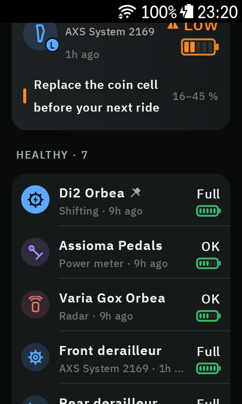

# Device Juice

Battery overview of every paired device on the Hammerhead Karoo 3: shifting, power meter, radar,
lights, heart rate and the Karoo itself. It answers "can I ride?" before the ride and "what do I charge
tonight?" after it.



## What it does

- **Overview screen.** A verdict at the top ("All set", "Charge 2 devices", "1 device won't last the
  ride"), then cards for what needs attention and a compact list of the rest. Each device has a type
  badge in a fixed colour (shifting blue, power violet, radar red, light white, heart rate pink); the
  battery colour (green, yellow, orange, red, grey) is only on the battery gauge, value and advice.
- **Per part.** Multi-part groupsets (SRAM AXS) get one row per derailleur and shifter, with L/R tags.
  Di2 through Ki2 shows the exact % that Ki2 streams.
- **Before the ride.** Opening a ride page while not recording gives one notification if anything is
  low. Starting a ride shows an in-ride alert for anything red or orange.
- **After the ride.** A notification says what to charge ("Charge Karoo tonight · 1 more before your
  next ride"). Open shows the "After the ride" screen with each device's drop on that ride.
- **Rides left.** Exact sources (the Karoo, Di2 via Ki2) learn their drain from your last 6 rides:
  "~3 rides left · your last 6 rides". Other devices use a rated battery life per type:
  "~32 h left · rated life". Coin cells and heart-rate straps get no estimate.
- **Data fields.** *Weakest battery* shows the emptiest device, coloured by level. *Battery warning* is
  a strip that stays blank until something is low.
- **Settings.** Light mode, each alert on or off, the % where each colour starts, hidden and renamed
  devices. Long-press a device on the overview to pin it to the top of its group, rename it or hide it.

Only devices in the active ride profile count for the verdict; the others sit dimmed at the bottom.

## Install

1. On your phone, open the latest release:
   <https://github.com/goranceko/hammerhead-karoo-extensions/releases/latest>
2. Long-press `device-juice.apk`, copy the link, and share it to the **Hammerhead Companion** app. The
   Karoo downloads and installs it.
3. On the Karoo, open **Device Juice** from the app list once, so Karoo starts the extension.

Updates: the Karoo checks `manifest.json` in the latest release and offers new versions under
Extensions.

With a USB cable and adb instead:

```bash
adb install -r device-juice.apk
```

## Add the data fields to a ride page

Karoo → Profiles → your profile → a data page → tap a field → the extension (puzzle) filter →
**Device Juice** → *Weakest battery* or *Battery warning*.

## What the levels mean

Most sensors only report a level to the Karoo, not a %. Device Juice shows the level word and its range:

| Level | Range | Colour |
|---|---|---|
| Full | over 95 % | green |
| Good | 81–95 % | green |
| OK | 46–80 % | green |
| Low | 16–45 % | orange |
| Critical | 1–15 % | red |

Exact % (the Karoo, Di2 via Ki2) uses the thresholds in Settings: green from 50 %, yellow from 30 %,
orange from 15 %, red below.

## Limits

- The Karoo refreshes ANT+ and Ki2 batteries about every 15 minutes while connected, and BLE batteries
  only when the sensor connects. A reading older than 7 days turns grey ("Not seen since …").
- The rated battery lives (Karoo 12 h, power meter 50 h, radar 8 h, light 6 h, electronic shifting
  35 h) come from manufacturer claims and are rough; learned rates replace them where the source is exact.
- Everything stays on the Karoo. Nothing is sent anywhere.

## Development

See the [root README](../README.md) for building, [PLAN.md](PLAN.md) for the design and milestones,
and [SPIKE.md](SPIKE.md) for what the Karoo actually reports.

Releasing: bump `versionCode` / `versionName` in `app/build.gradle.kts` and `latestVersion` /
`latestVersionCode` in `app/manifest.json`, then push a tag `device-juice-v<version>`. CI checks that
the tag matches `manifest.json`, builds the release APK and publishes the GitHub release.

Signing: releases use a private key when the `RELEASE_KEYSTORE_BASE64`, `RELEASE_STORE_PASSWORD`,
`RELEASE_KEY_ALIAS` and `RELEASE_KEY_PASSWORD` repository secrets are set; otherwise they use the shared
key committed in `app/debug.keystore`, which lets local builds and releases update each other.
